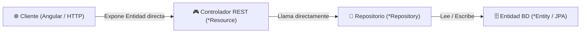
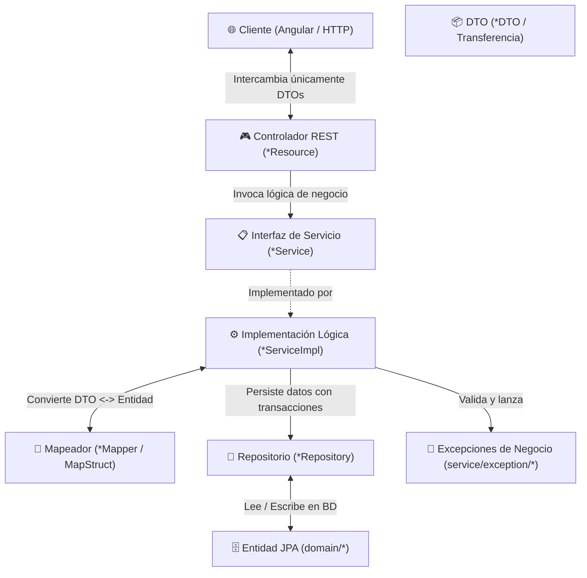

# 📘 Comparativa de Arquitectura del Backend: Antes vs. Después

Este documento detalla la evolución arquitectónica aplicada al backend del proyecto **`ejemplo01`** (Librería / Venta de Libros y Licencias Digitales), comparando el estado inicial generado por defecto con la estructura limpia y modular adaptada según los estándares de ingeniería y buenas prácticas aplicadas en tu curso de IDAT.

---

## 1. Resumen Visual de la Transformación

### 🔴 Antes (Arquitectura Acoplada por Defecto)

El controlador REST interactuaba directamente con la base de datos y exponía las entidades JPA al exterior sin capas intermedias.



---

### 🟢 Después (Arquitectura Limpia por Capas Adaptada)

Flujo desacoplado y seguro con DTOs, Mappers MapStruct, Interfaces de Servicio y Manejo Centralizado de Excepciones.



---

## 2. Cuadro Comparativo Detallado

| Criterio                    | 🔴 Estado Original (Por Defecto)                                                                  | 🟢 Estado Actual (Adaptado)                                                                                                                   |
| :-------------------------- | :------------------------------------------------------------------------------------------------ | :-------------------------------------------------------------------------------------------------------------------------------------------- |
| **Flujo de Peticiones**     | `Controller` ➡️ `Repository`                                                                      | `Controller` ➡️ `Service` ➡️ `ServiceImpl` ➡️ `Repository`                                                                                    |
| **Exposición de Datos**     | Se exponía la entidad JPA (`domain.Libro`) directamente en las respuestas JSON.                   | Se encapsula en objetos **DTO** (`service.dto.LibroDTO`). La entidad nunca sale del servidor.                                                 |
| **Transformación de Datos** | Inexistente (se guardaban y recibían entidades completas).                                        | Automática con **MapStruct** (`service.mapper.*Mapper`), convirtiendo entidades a DTOs de forma eficiente.                                    |
| **Lógica de Negocio**       | Forzada dentro de los controladores o inexistente.                                                | Centralizada en clases `@Service` con control de transacciones `@Transactional`.                                                              |
| **Manejo de Errores**       | Errores genéricos de base de datos o alertas por defecto.                                         | Excepciones personalizadas (`BusinessException`, `RecursoNoEncontradoException`, `DuplicateResourceException`, `StockInsuficienteException`). |
| **Seguridad de Datos**      | Vulnerable a _Mass Assignment_ (el cliente podía alterar IDs o campos de auditoría directamente). | Protegido: los DTOs filtran qué atributos viajan desde y hacia el cliente.                                                                    |
| **Paginación**              | Consultas completas sin paginación estándar.                                                      | Paginación nativa (`Spring Data Pageable`) optimizada para alto volumen de registros.                                                         |

---

## 3. Comparativa de Código Fuente

### A. Controlador REST (`LibroResource.java`)

#### 🔴 Código Original (Acoplado):

```java
@RestController
@RequestMapping("/api/libros")
public class LibroResource {

  // ❌ Acoplamiento directo a la base de datos
  private final LibroRepository libroRepository;

  public LibroResource(LibroRepository libroRepository) {
    this.libroRepository = libroRepository;
  }

  @PostMapping("")
  public ResponseEntity<Libro> createLibro(@Valid @RequestBody Libro libro) {
    // ❌ Manipulación y guardado directo de la entidad JPA
    Libro result = libroRepository.save(libro);
    return ResponseEntity.ok(result);
  }
}
```

#### 🟢 Código Adaptado (Limpio):

```java
@RestController
@RequestMapping("/api/libros")
public class LibroResource {

  // ✅ Inyección de la interfaz de negocio (desacoplado)
  private final LibroService libroService;

  public LibroResource(LibroService libroService) {
    this.libroService = libroService;
  }

  @PostMapping("")
  public ResponseEntity<LibroDTO> createLibro(@Valid @RequestBody LibroDTO libroDTO) {
    // ✅ Solo recibe y devuelve DTOs; la lógica reside en el Servicio
    LibroDTO result = libroService.save(libroDTO);
    return ResponseEntity.ok(result);
  }
}
```

---

### B. Capa de Servicio (`LibroServiceImpl.java`)

> [!NOTE]
> En la versión original esta clase **no existía** para las entidades del modelo. Ahora cada entidad cuenta con su servicio dedicado.

```java
@Service
@Transactional
public class LibroServiceImpl implements LibroService {

  private final LibroRepository libroRepository;
  private final LibroMapper libroMapper;

  public LibroServiceImpl(LibroRepository libroRepository, LibroMapper libroMapper) {
    this.libroRepository = libroRepository;
    this.libroMapper = libroMapper;
  }

  @Override
  public LibroDTO save(LibroDTO libroDTO) {
    // 1. Convierte DTO a Entidad JPA
    Libro libro = libroMapper.toEntity(libroDTO);
    // 2. Persiste en base de datos con control transaccional
    libro = libroRepository.save(libro);
    // 3. Retorna el DTO de respuesta
    return libroMapper.toDto(libro);
  }
}
```

---

## 4. Estructura de Paquetes Resultante

```
src/main/java/com/mycompany/myapp/
│
├── web/rest/                     # Controladores REST (endpoints HTTP)
│   ├── LibroResource.java
│   ├── VentaResource.java
│   └── ...
│
├── service/                      # Interfaces de Servicio
│   ├── LibroService.java
│   ├── VentaService.java
│   │
│   ├── impl/                     # Implementación de lógica de negocio
│   │   ├── LibroServiceImpl.java
│   │   ├── VentaServiceImpl.java
│   │   └── ...
│   │
│   ├── dto/                      # Objetos de Transferencia de Datos
│   │   ├── LibroDTO.java
│   │   ├── VentaDTO.java
│   │   └── ...
│   │
│   ├── mapper/                   # Mapeadores MapStruct
│   │   ├── LibroMapper.java
│   │   ├── VentaMapper.java
│   │   └── ...
│   │
│   └── exception/                # Excepciones de negocio personalizadas
│       ├── BusinessException.java
│       ├── RecursoNoEncontradoException.java
│       ├── DuplicateResourceException.java
│       └── StockInsuficienteException.java
│
├── domain/                       # Entidades JPA (Mapeo relacional ORM)
│   ├── Libro.java
│   ├── Venta.java
│   └── ...
│
└── repository/                   # Repositorios Spring Data JPA
    ├── LibroRepository.java
    ├── VentaRepository.java
    └── ...
```

---

## 5. Compatibilidad Garantizada

> [!TIP]
> A pesar de transformar profundamente el backend hacia el estándar de capas, **el Frontend (Angular) y las APIs REST conservan los mismos contratos JSON**. Esto permite que todas las pantallas generadas (CRUDs de Libros, Ventas, Licencias, Autores, etc.) sigan funcionando de forma transparente y sin errores.
